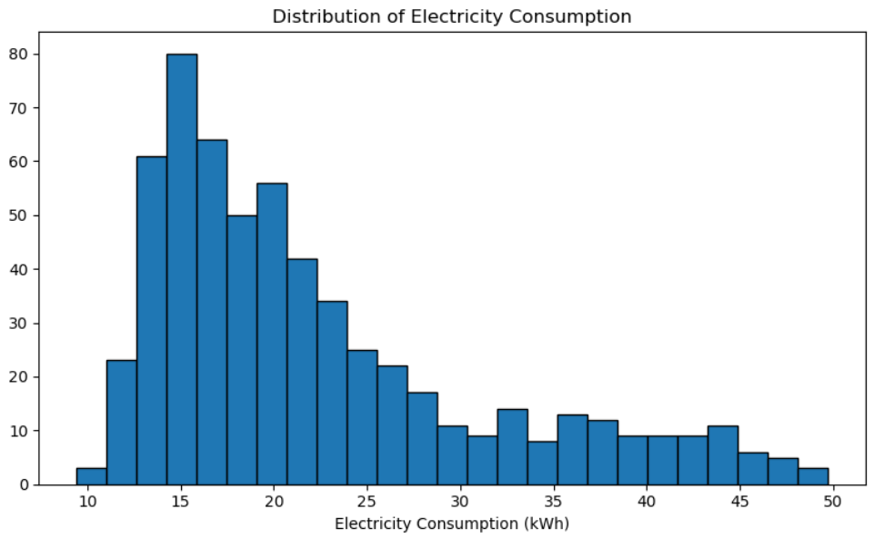
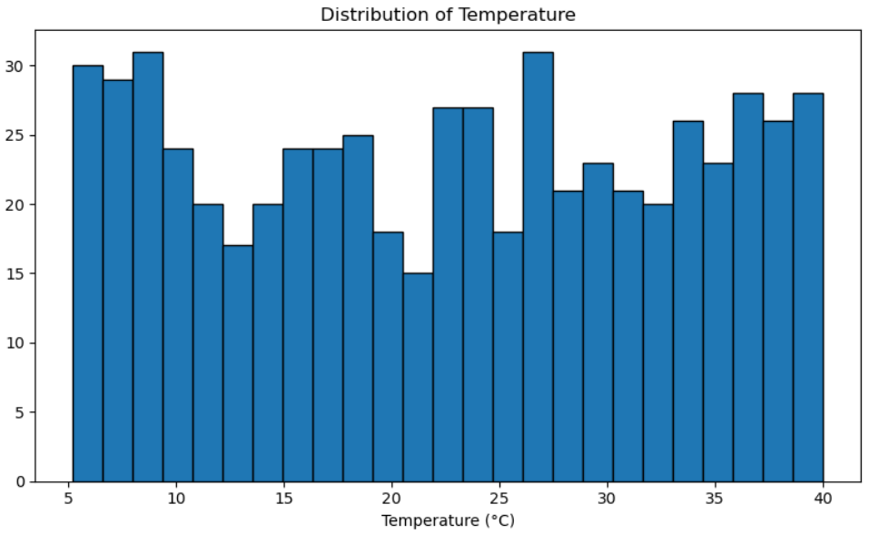
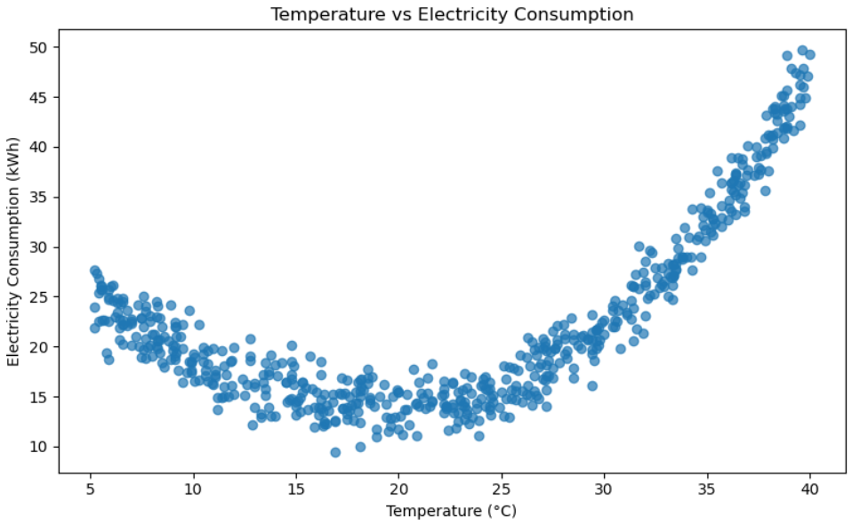
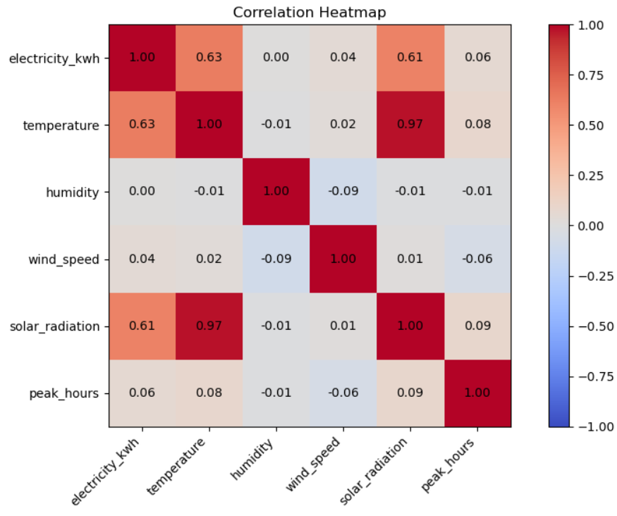
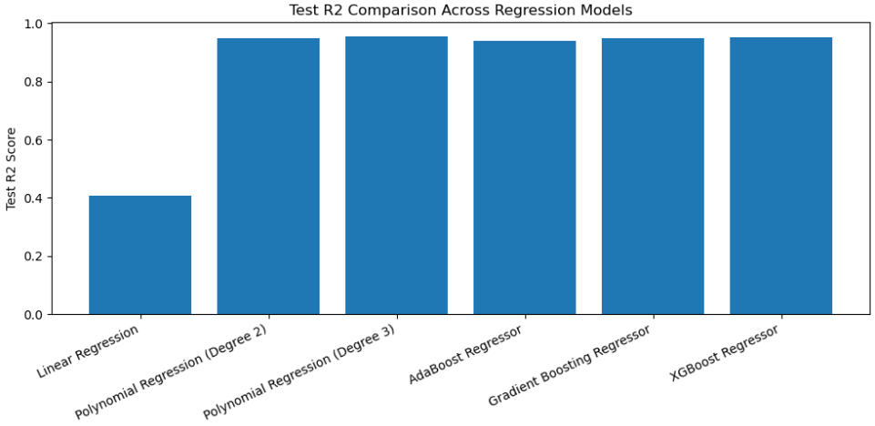

# Electricity Consumption Prediction

An end-to-end machine learning project to predict electricity consumption using weather-related features. This project explores Linear Regression, Polynomial Regression, and ensemble boosting algorithms, followed by model performance comparison.

## Project Overview

Electricity consumption can be influenced by several environmental factors. In this project, we explore the relationship between temperature and electricity usage and build regression models to predict electricity consumption.

The project focuses on understanding nonlinear relationships through Polynomial Regression and comparing its performance with other regression algorithms.

## Dataset Information

- **Total observations:** 600
- **Features:** 6
- **Target variable:** `electricity_kwh`

### Features

| Feature | Description |
|---|---|
| temperature | Temperature measurement |
| humidity | Humidity measurement |
| wind_speed | Wind speed measurement |
| solar_radiation | Solar radiation measurement |
| peak_hours | Peak-hour indicator |
| day_type | Type of day |

**Target:** `electricity_kwh` – Electricity consumption.

After preprocessing, 596 records were retained for modeling.

*Note: The dataset does not contain timestamp information, so the time interval represented by each observation is not specified.*

## Exploratory Data Analysis (EDA)

The dataset was explored using visualizations to understand electricity consumption patterns and relationships between variables.

### 1. Electricity Consumption Distribution


### 2. Temperature Distribution


### 3. Temperature vs Electricity Consumption


### 4. Correlation Heatmap


### 5. Model Performance Comparison


## Data Preprocessing

- Inspected the dataset structure and data types.
- Checked for missing values and duplicate records.
- Converted temperature values into numeric format where necessary.
- Removed records with missing values in the required modeling columns.
- Selected temperature as the input feature and electricity consumption as the target.
- Split the dataset into training and testing sets.

## Machine Learning Models

The following regression algorithms were implemented and evaluated:

1. Linear Regression
2. Polynomial Regression (Degree 2)
3. Polynomial Regression (Degree 3)
4. AdaBoost Regressor
5. Gradient Boosting Regressor
6. XGBoost Regressor

## Model Evaluation

Models were evaluated using:

- R² Score
- Root Mean Squared Error (RMSE)

### Performance Comparison

| Model | Train R² | Test R² | Test RMSE |
|---|---:|---:|---:|
| Linear Regression | 0.3917 | 0.4086 | 6.7781 |
| Polynomial Regression (Degree 2) | 0.9539 | 0.9479 | 2.0109 |
| Polynomial Regression (Degree 3) | 0.9586 | **0.9550** | **1.8702** |
| AdaBoost Regressor | 0.9545 | 0.9395 | 2.1679 |
| Gradient Boosting Regressor | 0.9716 | 0.9477 | 2.0158 |
| XGBoost Regressor | 0.9655 | 0.9506 | 1.9591 |

## Key Observations

- Linear Regression showed limited performance, indicating a nonlinear relationship between temperature and electricity consumption.
- Polynomial Regression significantly improved prediction performance.
- Polynomial Regression with Degree 3 achieved the highest test R² score and lowest test RMSE among the evaluated models.
- The ensemble boosting algorithms also achieved strong prediction results.
- Comparing multiple algorithms helped identify the best-performing model for this dataset.

## Technologies Used

- Python
- Pandas
- NumPy
- Matplotlib
- Seaborn
- Scikit-learn
- XGBoost
- Jupyter Notebook

## Project Structure

```text
electricity-consumption-prediction/
│
├── images/
│   ├── electricity-consumption-distribution.png
│   ├── temperature-distribution.png
│   ├── temperature-vs-consumption.png
│   ├── correlation-heatmap.png
│   └── model-performance-comparison.png
│
├── electricity_weather.csv
├── electricity_weather_poly_reg_final.ipynb
└── README.md
```

## Conclusion

This project demonstrates how regression algorithms can be applied to electricity consumption prediction. Polynomial Regression captured the nonlinear relationship more effectively than the Linear Regression baseline, while ensemble boosting algorithms provided additional performance comparisons.

Polynomial Regression with Degree 3 achieved the best test performance among the evaluated models.


